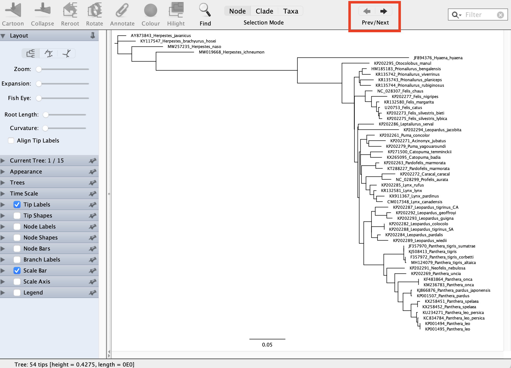

# Tutorial 6: Gene tree summary methods 🪾

It is quite often observed that phylogenetic relationships inferred from single genes differ from the tree that is inferred using all the available data. Sometimes this is simply due to the single genes not having enough phylogenetic signal, and thus they cannot resolve the relationships in question. But there are also biological reasons why this could happen, of which two are well studied. The first is Incomplete Lineage Sorting (ILS), which basically means that gene polymorphisms in ancestral populations are carried over to the descendant species. This in turn means that some haplotypes in one species will be more related to haplotypes in another species than to other haplotypes in the same species. The second biological reason that can lead to so-called gene tree/species tree conflicts is hybridization (also called introgression or horizontal transfer). 

Various methods have been developed to investigate these patterns. We will use [wASTRAL](https://github.com/chaoszhang/ASTER/blob/master/tutorial/wastral.md), a threshold-free weighting edition of the program ASTRAL, which is consistent under the multi-species coalescent method. This program is part of the Accurate Species Tree EstimatoR (ASTER❋). You can download the package from its [GitHub repository](https://github.com/chaoszhang/ASTER). wASTRAL attempts to find the species tree that agrees with the largest number of quartet trees induced by the set of gene trees.

wASTRAL is a commandline driven program, but works very simply. The input file is a file with all the gene trees that one is interested in, so to do an ASTRAL analysis, we first need to generate gene trees. This can be done with IQ-TREE or MrBayes, or any other program that can generate a phylogenetic tree from DNA data. In principle one could do this one by one for each gene, but that would be tedious if one has a large number of genes (e.g. 100s or 1000s of genes). Fortunately, IQ-TREE has a command that will do this for you automatically, either based on a folder with the individual genes in separate files (Fasta or Phylip format), or based on a concatenated dataset and a gene partition file. 

We will now use the ten aligned nuclear genes that we have already inferred a ML tree with and infer all gene trees with one command, `-S`. Estimating the gene trees is thus very easy, you just run the following command:

```
iqtree -S final_nuc_alignments --prefix genes -B 1000 -T AUTO
```
After a couple of minutes you should have a number of files with the name `genes.*`. The file we are interested in is `genes.treefile`, which should have ten trees in it (one tree for each gene). You can open this file in **FigTree**, and flip through the different trees by clicking on the arrows on the top right (see red rectangle below) in the program. *Do they all look like they have the same topology?* If you look very carefully, you will notice some trees are missing one or two species. This is because that particular gene was missing from the mitochondrial genome data, perhaps because the quality of the sequence was not good.

<p align="center"></p>

Now, you run the following command to summarize the gene trees:

```
wastral -o wastral.tre -i genes.treefile
```

The command `-o` is used to designate the output file, which you should name `wastral.tre`, and this is followed by the input file `genes.treefile` which you obtained from the previous run.

Now have a look at the `wastral.tre` file in **FigTree**. *Does it differ from the tree you have previously gotten when analysing the concatenated data?*
