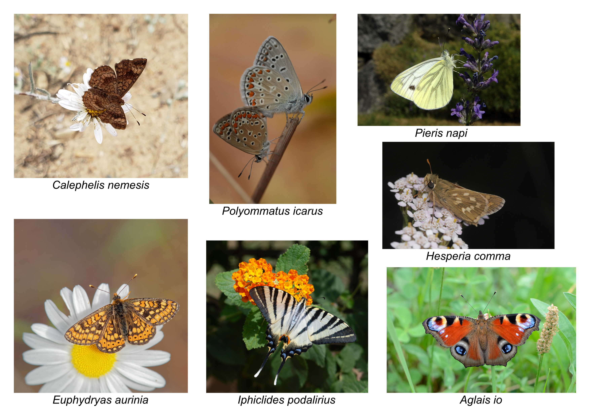

# Tutorial 2: Identifying genes in your assemblies

## Background

In most cases, to set up a phylogenomic dataset, you will need to identify
orthologous genes in your assemblies and align each gene across your taxa.
There are multiple ways to do this, here we will utilize one common route
that you've already seen: BUSCO. BUSCO compiles datasets of single copy
orthologous genes for different taxonomic groups. It also provides a tool
you can use to identify genes in these datasets in your assemblies. These
are not only good for assessing completeness as we have seen, but also as
a means to get gene sequences.

For this tutorial you will run BUSCO on a couple of butterfly assemblies,
learn to extract the BUSCO genes from them and how to set up files for
alignment.

## Downloading the assemblies

BUSCO can take awhile to run, so for this tutorial, we will just run it on
one chromosome for a couple of species to get a feeling for it. Below, you'll
see a list of butterfly species that we will be including in our tree. Start
by picking two and downloading their reference genome assemblies:

| Species | Accession | Family | Superfamily |
| --- | --- | --- | --- |
| *Hesperia comma* | GCA_905404135.1 | Hesperiidae | Papilionoidea |
| *Ochlodes sylvanus* | GCA_905404295.2 | Hesperiidae | Papilionoidea |
| *Thymelicus lineola* | GCA_963932265.1 | Hesperiidae | Papilionoidea |
| *Aricia agestis* | GCA_944452695.1 | Lycaenidae | Papilionoidea |
| *Polyommatus icarus* | GCA_937595015.1 | Lycaenidae | Papilionoidea |
| *Scolitantides orion* | GCA_964345685.1 | Lycaenidae | Papilionoidea |
| *Euphydryas aurinia* | GCA_975146965.1 | Nymphalidae | Papilionoidea |
| *Aglais io* | GCA_905147045.1 | Nymphalidae | Papilionoidea |
| *Vanessa atalanta* | GCA_905147765.2 | Nymphalidae | Papilionoidea |
| *Graphium eurypylus* | GCA_040363725.1 | Papilionidae | Papilionoidea |
| *Iphiclides podalirius* | GCA_933534255.1 | Papilionidae | Papilionoidea |
| *Papilio elwesi* | GCA_029849275.1 | Papilionidae | Papilionoidea |
| *Anthocharis cardamines* | GCA_905404175.1 | Pieridae | Papilionoidea |
| *Colias croceus* | GCA_905220415.1 | Pieridae | Papilionoidea |
| *Pieris napi* | GCA_905475465.2 | Pieridae | Papilionoidea |
| *Macrosoma leucophasiata* | GCA_036365455.1 | Hedylidae | Papilionoidea |
| *Calephelis nemesis* | GCA_002245505.1 | Riodinidae | Papilionoidea |
| *Bombyx mori* | GCA_030269925.2 | Bombycidae | Bombycoidea |
| *Cossus cossus* | GCA_965117205.1 | Cossidae | Cossoidea |
| *Epermenia chaerophyllella* | GCA_964235415.1 | Epermeniidae | Epermenioidea |
| *Bryotropha terrella* | GCA_964059635.1 | Gelechiidae | Gelechioidea |
| *Pyralis farinalis* | GCA_947507595.1 | Pyralidae | Pyraloidea |



To find published genome assemblies, you can look for them on
[NCBI](https://www.ncbi.nlm.nih.gov/) and [ENA](https://www.ebi.ac.uk/).
These two repositories mirror each other, so data on one can be found on
the other. The accession in the table above is a unique identifier for a
resource on these sites, in this case the reference genome identifies. However,
you don't need to know this, and instead can [search your species to see what
reference genomes are available here](https://www.ncbi.nlm.nih.gov/datasets/genome/).
Give it a try for one of the above and you should find the accession listed. Some
species may have more than one assembly, but only one will be the reference assembly.

Instead of clicking through these pages, we will download the genomes with the NCBI
command line toolkit. You can use a species name or the assembly accession to download:

```bash
mkdir -p data/references
# download with the taxon name
datasets download genome taxon \
    "Hesperia comma" \
    --include genome \
    --chromosomes 1 \
    --reference \
    --filename data/references/Hesperia_comma_chr1.zip

# download with the accession number
datasets download genome accession \
    "GCA_905404135.1" \
    --include genome \
    --chromosomes 1 \
    --reference \
    --filename data/references/Hesperia_comma_chr1.zip

# you can also download multiple at once
datasets download genome taxon \
    "Hesperia comma,Ochlodes sylvanus,Thymelicus lineola" \
    --include genome \
    --chromosomes 1 \
    --reference \
    --filename data/references/Hesperiidae_chr1.zip
```

Here, we tell the tool we want to download a genome with `datasets download genome`,
then whether we will use a `taxon` or `accession` as the identifier, then we give the
identifiers of what we want to download. `--include genome` means the data package only
downloads the genome FASTA file, `--chromosomes 1` limits the download to only the first
chromosome, `--reference` only downloads the reference genome (without it, all assemblies
for a taxon will be downloaded; it is not needed for accession downloads if the accession
is the reference assembly), `--filename` gives the path to the zip archive it will
download.

Once you've downloaded a couple genomes either in one or more commands, unzip them with:

```bash
unzip -d <output_directory> <zip_file>
```

where `<output_directory>` is replaced with the path you want the files to be extracted to
and `<zip_file>` is the path to the zip you downloaded. Explore the structure of the output
to find the fasta files, record their paths, then move on to running BUSCO.

## Running BUSCO

BUSCO has compiled datasets for a large number of organismal groups, and you can use the one
most suitable for the breadth of your tree:

```bash
busco --list-datasets
```

Look through the options and notice that BUSCO provides datasets for groups at
different taxonomic levels. A lineage is not available or appropriate for every
organism, so not every option will work for these butterflies. For this tutorial,
choose either `lepidoptera_odb12` or the more specific `papilionoidea_odb12`.
Use the same lineage dataset for every species so that the results are
comparable. Replace the example assembly path with the FASTA path you recorded
after unzipping the download, and change `SPECIES` for each assembly so that
every run has its own output directory:

```bash
SPECIES=Hesperia_comma
ASSEMBLY=/path/to/Hesperia_comma_chr1.fna
LINEAGE=lepidoptera_odb12
# Alternatively: LINEAGE=papilionoidea_odb12

mkdir -p outputs/busco
busco \
    -i "$ASSEMBLY" \
    -o "$SPECIES" \
    --out_path outputs/busco \
    -l "$LINEAGE" \
    -c 8 \
    -m genome \
    --metaeuk
```

`-i` is the assembly FASTA, `-o` names this run, and `--out_path` sets the
directory where BUSCO writes its results. `-l` selects the lineage dataset,
`-c` sets the number of CPUs, and `-m genome` tells BUSCO that the input is a
genome assembly. MetaEuk predicts genes in the assembly so BUSCO can search
them for the expected orthologs. The first run may take longer while BUSCO
downloads the lineage dataset.

Let the run finish. Don't be afraid if the completeness is low, remember we
are only searching one chromosome. Now, explore its output directory:

```bash
ls outputs/busco
cd outputs/busco/Hesperia_comma
ls
```

Replace `Hesperia_comma` with the run name you chose for `-o`. Look through
the files and folders: the output includes a completeness summary and a
`run_<lineage>` directory, where `<lineage>` is the BUSCO dataset you selected.
Move into that directory, then continue into `busco_sequences` and
`single_copy_busco_sequences`:

```bash
cd run_lepidoptera_odb12/busco_sequences/single_copy_busco_sequences
ls
```

If you chose `papilionoidea_odb12`, use `run_papilionoidea_odb12` instead.
This folder contains the sequences for BUSCO genes found complete and in one
copy in this assembly.

Each gene has files sharing the same BUSCO identifier: `.fna` contains its
coding nucleotide (DNA) sequence, `.faa` its translated amino acid (protein)
sequence, and `.gff` its location in the assembly. Choose an identifier and
open its `.fna` and `.faa` files in a text editor. Both are plain-text FASTA
files: each record starts with a `>` header followed by sequence lines. Compare
the two files to see the DNA sequence and its translation. BUSCO may also report
genes in other categories, such as duplicated or fragmented genes; for now,
focus on complete single-copy genes. Repeat the exploration for your other
assemblies and compare files with matching BUSCO identifiers across the two species
you've run. Note that you may not find any matching ones, as even though we have chosen chromosome
1 from both species, they may not come from the same ancestral chromosome, as most
assemblies just number chromosomes by size.

## Translating this to real data

If you were to set up a phylogenomics dataset with BUSCO on these species, you'd
want to run BUSCO on all the species' full assemblies. Then, for each gene, you
would combine the `.fna` files across species, then do the same for each gene's
`.faa` file so that you have a `.fna` file and `.faa` file for each gene with
the unaligned nucleotide and protein sequences, respectively. Let's look at how
that would look for BUSCO 306631at7088 in two species:

**Hespeira comma's `306631at7088.fna`**:

```text
>306631at7088_58824_0:000347|FR990014.1:5036813-5092653|+
ATGAAGCTTCTCGCCAGTTTGTTGTTGCTGCCTCTGTGTCTCGGTCATCTCAACGTTTAC
CTGAGCAGCGCCGAAGTATGGAGATTACTTGGTCTGACAGCAGAGCTATTCTACGTCCGC
GAGGGGCAGATCAATTTCTACGCACTAACCTTCGTGGTGCCTGTTCCTGCCACTATCGAT
GAACTGCACTTCACATGGCAGAGTCTTCTTAGAAGACCGGTACCGTACACAGTTCAAGCG
CACATCGATGTAGACCGAGATTCATCAAAGCGAGGGGCGCTGCACCCGCCCACATTCAAC
ATATCCAAAGAAGGGTTCGTTCCAACAGAGCCGCAGACGTGGCGAGTGGACTTGCGATGT
ACGCGCTTGGTGGCTGCCGAGGTCGAAGTCACAATATCCTTAAACGTGTCCACTGGCTCG
TCATCAACTGCTCTGCAGTTTAAACGAAGAAAGTTCTGCCTGAAAGATATGCCTCAGCAA
GTCATCAAGGTGGACAATGTACACGCTCCGACCTCGGCTGATATATTCTATGCTGGGGCG
GGTTGTGCTGGAGGCGTCATCTTAATAGCGGCGGTGGCTGCTGTTGCTTGCCGCGCTCGG
GCAAGGAAGCTTCGACGAGCCAGAAGTGACGAGCAAGACGCCCACGCGTTTCTACCAGAT
TCCTCTTGCAAATCTGCCGCAAGTTACACCAGTTATCGTCGCCCAACGTCCTTGCCGGCC
GTGGCGGCAGAGGAAAGAGCCCGAGACCTGCAACAGAGAATAGCAGAGCTGACGATACAG
AGGTGTCGCGTTCGATTGCGGTCCGTGGCTATGGAGGGGACATTTGGGAGAGTCTACCGA
GGGACGTATGCGGACGAGGAAGCGAGAGAGCAAGAAGTTCTAGTTAAGACCGTTGCTGAA
CATGCTTCACAAGTACAGGTATCACTCCTTCTCCAAGAAGGTTGCATGCTATATGGGTTA
CATCACGAGCGAGTGCTATCTGTGCTTGGTGTGAGCATTGAGGACCAAACAGCGCCATTC
TTGCTGTACCCCTGGGGCGCCACTTGGAGGAATCTCAAACAGTTTCTGCTGGCCTGTCGC
GGCGTGACGGTAGGGGGCGCGGCCGGCACGGCACCTCCGCCCCCGTTGACGACGCAACAT
GTCGTGCGAATGGCTCTTCACGCCCTAGACGGCTTGTCTTACTTACACACTCAACATGTG
CTTCATAGGGACATTGCTGCCAGGAATTGTGTGGTGGATGAAAACCTTCGAGTGATGATT
GCGGATAACGCGTTGTCGCGGGATCTCTTTCCTGGAGACTACCACTGTCTGGGCGACAAC
GAGAACCGGCCCATCAAGTGGCTGGCGTTAGAAGCGCTGTCCAAGCGGCAGTTCAGCCCC
GCGGCTGATGTCTGGGCGCTGGGAGTGTTGCTGTGGGAGCTCACCACGCTGGCCCATCAG
CCGTACGCAGAGGTGGATCCGTTTGAGGTGGCCGCGTACTTGAGGGACGGGTACCGGTTG
CAGCAGCCGGCGAACTGTCCTGATGAATTGTTCGCAGTGATGGCGTATTGCTGGGCAATG
TCTCCGGACGACCGGCCCACGCTGCCCCAGCTACAGATCTTCCTGAGGGACTTCCACACG
CAACTCACGAGATTCGTC
```

**Ochlodes sylvanus's `306631at7088.fna`**:

```text
>306631at7088_58824_0:000347|FR990124.1:3954425-4002115|+
ATGAAGGTGCTCGCCGGTTTGTTGTTGCTGCCACTGTGTCTCGGTCACCTTAACGTTTAC
CTGAGCAGTGCCGAAGTATGGAGATTACTTGGTCTAACAGCAGAGCTGTTCTATGTCCGC
GAGGGGCAGATCAATTTCTACGCGCTCACCTTCGTGGTGCCCGTGCCTGCTACTATCGAT
GAGCTGCACTTCACATGGCAGAGTCTTCTTCGGAGACCGGTACCGTATACAGTCCACGCT
CACATCGAAGTAGACCGAGACGCGTCAAAGCGAGGGGCTCTGCACCCGCCGACATTCAAC
ATATCGAAGGAGGGTTTCGTTCCAACAGAGCCGCAGACGTGGCGAGTGGACTTGCGATGT
ACGCGCTTGGTGGCCGCCGAGGTCGAAGTCACGATATCCCTAAACGTGTCCACTGGCTCG
TCATCAACAGCTCTGCAGTTTAAGCGAAGGAAGTTCTGCCTGAAAGATATGCCTCAGCAA
GTCATCAAGGTGGACAATGTACACGCTCCGACCTCTGCGGATATATTCTACGCTGGGGCA
GGTTGCGCCGGAGGAGTGCTCCTAATAGCGGCGGTGGCTGCTGTTGCTTGTCGCGCTCGG
GCAAGGAAACTTCGACGAGCGCGTAGCGATGAGCAGGATGCCCACGCGTTTCTGCCGGAT
TCATCCTGCAAATCGGCCGCAAGCTACACCAGTTACCGACGCCCGACGTCCTTGCCAGCC
GTGGCGGCGGAGGAGAGAGCCAGAGACCTGCAACAGAGAATAGCAGAGCTGACGATACAG
AGGTGTCGCGTCCGATTGCGGTCCGTGGCTATGGAGGGGACGTTCGGGAGAGTCTACCGA
GGGACCTATGCGGACGAAGAGGCCAGAGAGCAAGAAGTTCTAGTTAAGACCGTCGCTGAA
CATGCTTCACAAGTACAGGTATGTATTCTTCTCCAAGAAGGTTGCATGCTATATGGATTG
CATCACGAGCGAGTGTTATCTGTGCTTGGCGTGAGCATCGAGGACCAAACGGCGCCTTTC
TTGCTGTACCCCTGGGGCGCCACTTGGAGGAATCTCAAACAGTTTCTGCTGGCGTGTCGC
GGCGTGACGGTGGGGGGCGCGGCCGGTACGGCGCCTCCGCCTCCGTTGACAACGCAGCAT
GTCGTGCGAATGGCTCTTCACGCCCTAGACGGCTTGTCCTACTTGCACACTCAACACGTT
CTGCATAGGGACATTGCGGCCAGGAATTGTGTGGTGGACGAGAACCTTCGAGTGATGATA
GCGGATAACGCGTTATCACGGGATCTGTTTCCCGGGGACTACCACTGTCTGGGTGACAAC
GAGAACCGGCCCATCAAGTGGCTGGCGTTGGAAGCCCTGTCCAAGCGGCAGTTCAGCCCC
GCGGCTGATGTCTGGGCGTTAGGGGTGCTGTTGTGGGAACTGACCACGCTGGCCCATCAG
CCGTACGCGGAGGTAGATCCGTTCGAAGTGGCCGCTTACTTGAGGGACGGGTATCGGTTG
CAGCAGCCGGCGAACTGTCCTGATGAATTGTTCGCAGTGATGGCGTATTGCTGGGCAATG
TCCCCGGACGACCGGCCCACACTGCCCCAGCTACAGATCTTCCTGAGAGACTTCCACACG
CAACTCACCAGATTCGTC
```

We can combine these into one `.fna` file, but we first need
to rename the sequences to reflect what species/taxon they come
from, so we would replace the header in the first to something
like this:

```text
>Hesperia_comma
ATGAAGCTTCTCGCCAGTTTGTTGTTGCTGCCTCTGTGTCTCGGTCATCTCAACGTTTAC
CTGAGCAGCGCCGAAGTATGGAGATTACTTGGTCTGACAGCAGAGCTATTCTACGTCCGC
GAGGGGCAGATCAATTTCTACGCACTAACCTTCGTGGTGCCTGTTCCTGCCACTATCGAT
GAACTGCACTTCACATGGCAGAGTCTTCTTAGAAGACCGGTACCGTACACAGTTCAAGCG
CACATCGATGTAGACCGAGATTCATCAAAGCGAGGGGCGCTGCACCCGCCCACATTC...
```

Notice that we don't add the gene name, this is important as the
sequence name needs to be the same in all gene fastas for the tree
inference to know they are from the same taxon. So a combined `.fna`
for this gene for these two species would be:

```text
>Hesperia_comma
ATGAAGCTTCTCGCCAGTTTGTTGTTGCTGCCTCTGTGTCTCGGTCATCTCAACGTTTAC
CTGAGCAGCGCCGAAGTATGGAGATTACTTGGTCTGACAGCAGAGCTATTCTACGTCCGC
GAGGGGCAGATCAATTTCTACGCACTAACCTTCGTGGTGCCTGTTCCTGCCACTATCGAT
GAACTGCACTTCACATGGCAGAGTCTTCTTAGAAGACCGGTACCGTACACAGTTCAA...
>Ochlodes_sylvanus
ATGAAGGTGCTCGCCGGTTTGTTGTTGCTGCCACTGTGTCTCGGTCACCTTAACGTTTAC
CTGAGCAGTGCCGAAGTATGGAGATTACTTGGTCTAACAGCAGAGCTGTTCTATGTCCGC
GAGGGGCAGATCAATTTCTACGCGCTCACCTTCGTGGTGCCCGTGCCTGCTACTATCGAT
GAGCTGCACTTCACATGGCAGAGTCTTCTTCGGAGACCGGTACCGTATACAGTCCAC...
```

As we won't have time to run BUSCO on all the species, take a moment
to practice making these files manually for a couple genes on the species
you ran them on. In reality, this is a bit tedious, so you probably will
need to set up a script for this, here is an example that might work for
this case:

```bash
# set the list of species you've run busco on
species="Hesperia_comma Ochlodes_sylvanus Thymelicus_lineola"
# list the .fna files in the single_copy_busco_sequences folder
buscos_found=$(
    for s in $(echo $species); do
        ls outputs/busco/${s}/run_lepidoptera_odb12/busco_sequences/single_copy_busco_sequences/*.fna | cut -f7 -d"/";
    done | sort -u
)

# for each busco, loop over the species, making a file with all available species sequences
mkdir -p outputs/busco/gene_fastas
for b in $(echo $buscos_found); do
    for s in $(echo $species); do
        if [[ -e outputs/busco/${s}/run_lepidoptera_odb12/busco_sequences/single_copy_busco_sequences/${b} ]]; then
            cat outputs/busco/${s}/run_lepidoptera_odb12/busco_sequences/single_copy_busco_sequences/${b} | sed "s/\>.*/\>${s}/g"
        fi
    done > outputs/busco/gene_fastas/${b}
done
```

## Annotating mitochondrial genomes with MITOS2

Mitochondrial genomes provide another set of genes for phylogenetic analysis.
Unlike the BUSCO exercise, here we will work with the mitochondrial chromosome
from **every species** in the table above, mitochondrial genomes are only ~15 kb
and are fast to annotate. We will use MITOS2 to predict protein-coding genes,
tRNAs, and rRNAs in each mitochondrial genome, then prepare a dataset of the
protein coding genes.

### Download the mitochondrial chromosomes

Use each species' **assembly accession** from the table to download its
mitochondrial chromosome. For example, for *Hesperia comma*:

```bash
mkdir -p data/mitochondria

datasets download genome accession GCA_905404135.1 \
    --include genome \
    --chromosomes MT \
    --filename data/mitochondria/Hesperia_comma_MT.zip

unzip data/mitochondria/Hesperia_comma_MT.zip -d data/mitochondria/Hesperia_comma
```

Remember, though, you can also download them all in one command if you pass the
accessions with commas in between them, you may just have to rename them to the
species after unzipping or initially refer to them by their accession, as NCBI
won't include the species name in the output.

`--chromosomes MT` requests the mitochondrial chromosome rather than chromosome
1. While common, this way of referring to the mitochondria is not always the
case, so be sure to check that you get all the assemblies you expect.

Explore each extracted package with `ls` and `cd` to find its genomic FASTA
file. Open the file and check that it contains one mitochondrial sequence:
there should be one FASTA header, beginning with `>`. Keep track of which
FASTA belongs to each species.

### Run MITOS2

MITOS2 is already installed in your active conda environment, but it also needs
a reference dataset. Use the metazoan `refseq89m` dataset from the
[MITOS2 reference data](https://zenodo.org/records/4284483). A good place to put
this is in your working directory in a `resources` folder. When you run the mitos
command, give the path to the extracted refseq89m folder after `--refseqver`.

Run MITOS2 on one mitochondrial FASTA at a time. Replace the input and reference
paths below with the actual paths on your computer:

```bash
mkdir -p outputs/mitos2/Hesperia_comma

runmitos.py \
    --input data/mitochondria/GCA_905404135.1/chrMT.fna \
    --code 5 \
    --refdir resources \
    --refseqver refseq89m \
    --outdir outputs/mitos2/Hesperia_comma
```

`--input` specifies the mitochondrial FASTA, `--code 5` selects the invertebrate
mitochondrial genetic code, `--refdir` specifies the folder you have extracted
refseq89m to, and `--refseqdir` points it to that specific version (multiple
refseq databases could live in that folder), and `--outdir` sets the output
directory. MITOS2 treats the sequence as circular by default, which will work
for all these as they are highly complete, but if you have an incomplete mitochondrial
sequence, you can also pass `--linear`.

### Explore the annotations

After a run finishes, explore the output gene sequences:

```bash
cd outputs/mitos2/Hesperia_comma
less result.fas
less result.faa
```

You'll find in there the nucleotide and amino acid sequences for all the annotated
genes and features. Just as described above, we will want to make a a nucleotide
and amino acid fasta file for each of the 13 coding genes (nad3, cox3, atp6, atp8,
cox2, cox1, nad2, nad1, cob, nad6, nad4l, nad4, nad5). These files will contain
the sequence for that gene for each species, with the identifier as the species name,
so `cox3.fna` might look like:

```text
>Hesperia_comma
ATGACAAACCATAACCACCCATATCATTTAGTAGATTATAGACCATGACCTTTAACAGGA
GCTATTGGAACTATAACTTTAGTTACTGGTATAGTAAAATGATTTCACAATTTAAATATA
AATTTATTAATTTTAGGATATTTAATTATTATTTTAACTATATATCAATGATGACGAGAT
ATTTGTCGAGAAGGAACTTTTCAAGGTAAACATACAACTTTTGTTTTAAAAGGATTACGA
TGAGGTATAATTTTATTTATTATTTCTGAAATTTTTTTCTTTATTTCTTTTTTTTGAGCT
TTTTTTCATAGTAGTCTTTCCCCAAATATTGAAATTGGATCTTCTTGACCTCCTGTAAAT
ATTATTCCATTTAATCCTTTCCAAATTCCATTATTAAATACTATTATTTTAATTACATCT
GGAGTAACTGTTACTTGAGCTCATCATGCTTTAATAGAGAATAATCATACTCAAACTAAA
CATAGTTTATTAATTACTATTTTGCTAGGAATTTATTTTACTATTCTTCAAGCTTATGAA
TATTATGAAGCACCTTTTTCTATCGCAGATAGAATTTATGGATCAACATTTTTTATAGCT
ACAGGATTCCATGGTATTCATGTAATTATTGGAACTATTTTTTTAATAACTTGTTTTTTT
CGACATTTATTTAATCATTTCTCAAACAAACATCACTTTGGATTTGAAGCTGCAGCATGA
TATTGACATTTTGTTGATGTAGTTTGATTATTTCTTTATATTTCTATTTATTGATGAGGT
AATTAA
>Ochlodes_sylvanus
ATGATAAATCATAATCACCCTTATCATTTAGTAGATTATAGTCCATGACCTTTAACAGGA
GCTATTGGAACTATAACTTTAGTTACTGGAATAGTAAAATGATTTCATAATTTTAATATA
AATTTATTAATTTTAGGATATTTAATTATTATTTTAACTATATATCAATGATGACGAGAT
ATTTGTCGAGAAGGAACTTTTCAAGGTAAACATACAACTTTTGTTTTAAAAGGATTACAA
TGAGGAATAATTCTATTTATTGTATCTGAAATTTTTTTTTTTTTATCTTTTTTCTGAGCA
TTTTTTCATAGAAGACTTTCCCCAAATATTGAAATTGGATCTTCATGACCTCCTGTTAAT
ATTATTCCATTTAATCCATTTCAAATTCCTCTATTAAATACTATTATTTTAATTACATCT
GGAGTAACAGTTACTTGAGCTCATCATGCTTTAATAGAAAATAACTTTACACAAACTAAA
CATAGTTTATTAATTACTATTATTTTAGGAATTTATTTTACTATTCTTCAAGCTTATGAA
TATTATGAAGCTTCTTTTTCAATTGCAGATAGAATTTATGGCTCAACATTTTTTATAGCT
ACTGGATTTCATGGTATTCATGTAATTATTGGAACTATTTTTTTATTAACTTGTTTTATT
CGTCATTTATTTTATCATTTTTCAAATAAACATCATTTTGGATTTGAAGCTGCAGCATGA
TATTGACATTTTGTTGATGTAGTTTGACTATTTTTATATATCTCTATTTATTGATGAGGT
AATTAA
```

Once you've put together a gene, open it up in Aliview, a free
alignment viewer you have installed:

```bash
aliview outputs/mitos2/gene_fastas/cox3.fna
```

Notice how the sequence length differs across species, though it
may be similar in more closely related ones. The next tutorial will
go into how we align these sequences so that we can identify
corresponding positions across species and use their similarities
and difference to infer their phylogenetic history.
