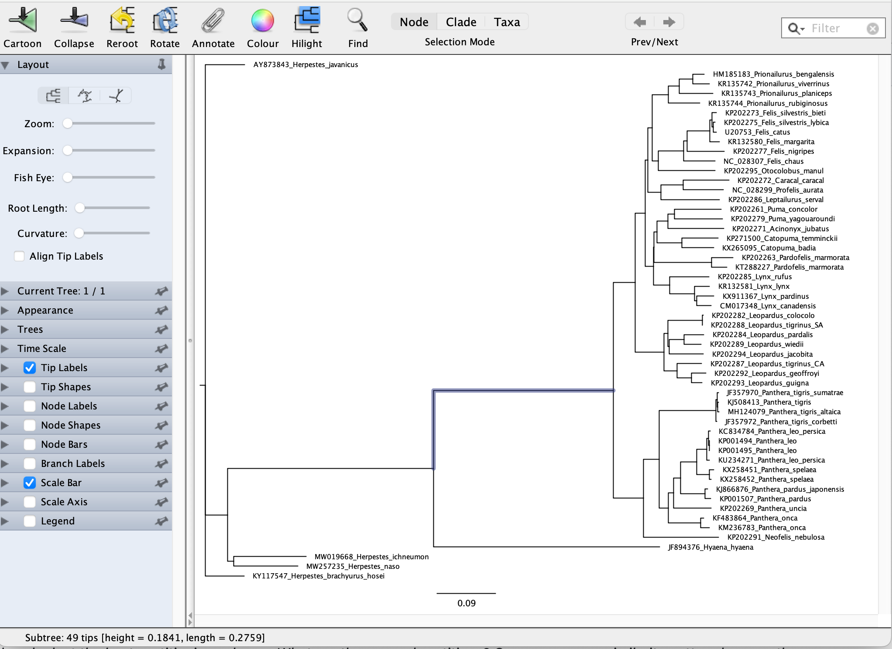
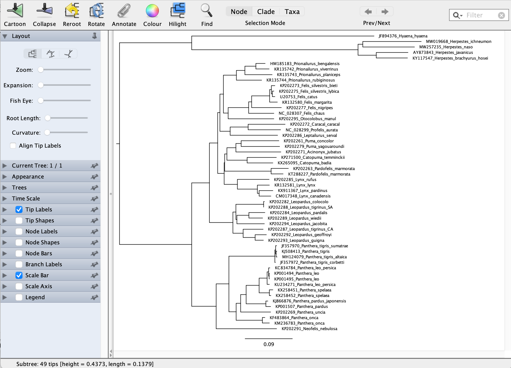

# Maximum-likelihood phylogenetic inference 📉

## IQ-TREE3
Now that we learned how to use IQ-TREE for model and partition search, we will move on to doing phylogenetic inference with it.

**Command line instructions and tree inference** 🪾

Tree inference is one of the most frequently used features of IQ-TREE and allows users to carry out phylogenetic analysis on a multiple sequence alignment (MSA). In the most basic case, no more than an MSA file is required to submit the job. Without further input, IQ-TREE will run with the default parameters and auto-detect the sequence type as well as the best-fitting substitution model. Additionally, Ultrafast Bootstrap ([Hoang et al., 2018](https://academic.oup.com/mbe/article/35/2/518/4565479)) and the SH-aLRT branch test ([Guindon et al., 2010](https://academic.oup.com/sysbio/article/59/3/307/1702850)) will be performed.

Go into the same folder in your terminal as you did for the [previous tutorial](../ModelSelection/Readme.md#Running-ModelFinder-with-IQ-TREE).


**Command reference**

`iqtree`: will call the executable in our activated Conda environment

`-p <alignment-folder>`: this option points your program to the alignment folder

`-m MFP+MERGE`: like the option `MF+MERGE` that we used last time, but actually does phylogenetic inference with the found best models for the best partitioning scheme

`-B`: will perfom Ultrafast Boostrapping

`-alrt`: will perform the SH-aLRT test

`-bnni`: reduces the risk of overestimating branch supports with UFBoot due to severe model violation


1. Now you can try to run a simple analysis by entering

```
iqtree -p final_nuc_alignments
```

In this case, IQ-TREE3 will first concatenate the sequences found in the folder *final_nuc_alignments* and then infer a tree from this concatenated dataset with the best-fit model automatically selected.


2. However, to find the best partition scheme by possibly merging partitions, followed by tree inference and branch support, run an analysis by entering:

```
iqtree -p final_nuc_alignments -m MFP+MERGE -B 1000 -alrt 1000 --prefix tree_inference -bnni
```

**Output Files to check**

   Suffix	     
   
- `.iqtree`          Full result of the run – this is the main report file

- `.log`	            Run log

- `.treefile`	      Maximum likelihood tree in NEWICK format, can be visualized with treeviewer programs

- `.ufboot`          Bootstrap trees

- `.best_scheme.nex` Best partitioning scheme


3. Now, infer a tree also from the mitochondrial genes.

**Congratulations! Now that you have run the analyses, you can compare the results of the trees.**


# Simple tree visualization 🪾

To have a quick look at your inferred trees, we suggest you open your IQ-TREE `.treefile` in FigTree. You can do this from your terminal by typing `figtree <treefile>`. An example of what a tree looks like in FigTree is shown below in a screenshot.

<p align="center"></p>

IQ-TREE estimates an unrooted tree unless a root was specified in the
analysis. The way an unrooted tree is drawn does not identify a biologically
meaningful root, and the tree is therefore in FigTree rooted by default on the first taxon in your dataset or on the longest branch in the dataset. This is why we have included outgroups to the butterflies in our tree inference, and we can now reroot the tree using these. Find the clade containing the outgroup taxa (**WHICH clade?? Can we point towards a study??**) and select the branch leading to the clade in FigTree, then click 'Reroot' in the top panel. Note that these examples use a different set of taxa than you used, but the interface remains the same.

<p align="center"></p>

<p align="center"></p>

Inspect the tip names and branch lengths, and check the internal labels for the support values reported by your analysis.

**Questions**

1. *Are the UFBoot2 values higher/lower compared to those recovered from the SH-like in IQTREE?*

2. *How are the nodes/relationships supported?*

3. *Take a look at the best partitioning scheme. What are the merged partitions? Can you see any similarity pattern beween the merged partitions?*


