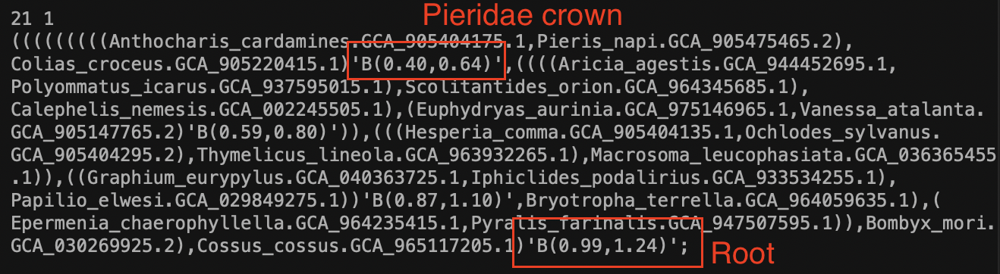
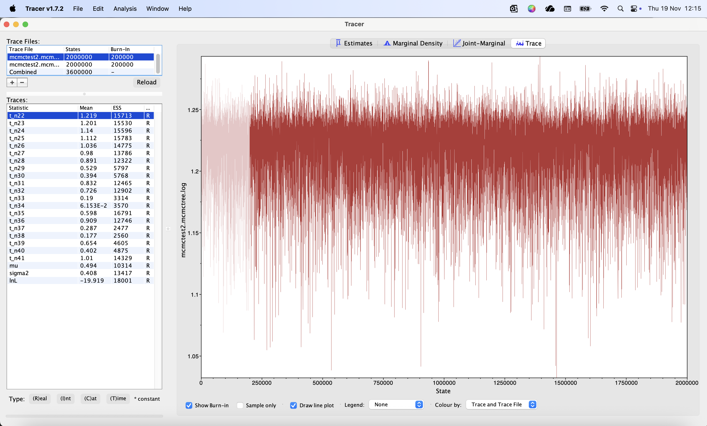
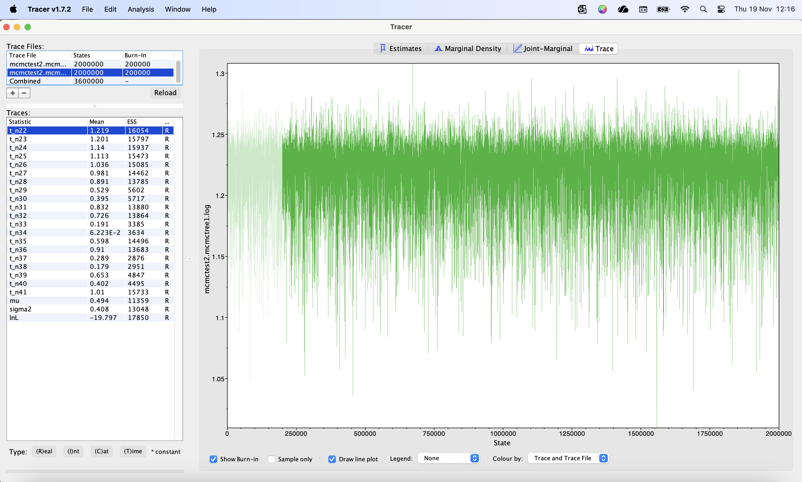
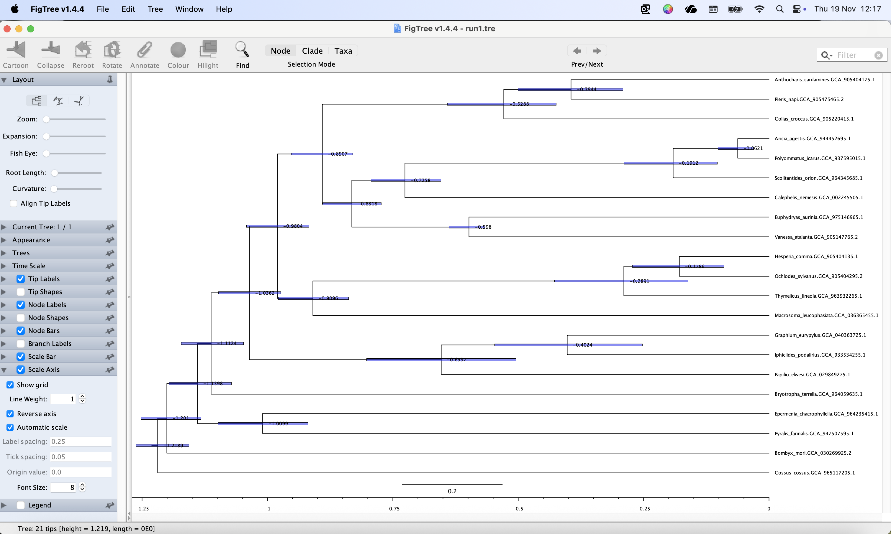

# Tutorial 8: Dating the butterfly tree with IQ2MC 🦋

In this tutorial, we will work on dating your tree inferred in the
[maximum-likelihood tree tutorial](../MaximumLikelihood/Readme.md). We will
use MCMCtree to do the dating, with its implementation in IQ-TREE 3 called
**IQ2MC**. This combines IQ-TREE 3 and MCMCtree: IQ-TREE calculates an
approximate sequence likelihood for a fixed tree, and MCMCtree samples
divergence times using a molecular clock and calibration priors. One of the
advantages here is that by calculating the approximate likelihood with IQ-TREE,
we can utilize the same partitions and models we used in tree inference.

The result we get here will not change the topology. Rather the branch lengths,
which are now in units of substitutions per site, will be converted into units
of time. This is done with calibrations, portions of the tree you have an estimated
timing of divergence, either from fossils or other trees calibrated with such
information. We will use the latter of these, secondary calibrations from published
divergence-time estimates ([Kawahara et al. 2019](https://www.pnas.org/doi/10.1073/pnas.1907847116); *PNAS*).

## Extra things we'll need 🛠️

Most of what we need is already in our conda environment, but we will need
two more tools. To use IQ2MC, we need a special version of MCMCtree distributed
in [IQ-TREE's version of PAML](https://github.com/iqtree/paml) which includes
modifications for IQ-TREE's version of the MCMCtree configuration file (or
control file).

Keep your `phylo` environment active and let's build the special version of
IQ-TREE. In your working directory, we will set this up with the following
commands:

```bash
git clone https://github.com/iqtree/paml.git
make -C paml/src mcmctree
```

In the commands below, replace `/path/to/paml/src/mcmctree` with the actual
path to that file.

You'll also need Tracer, which we haven't installed yet. Install it to your
conda environment with:

```bash
conda install bioconda::tracer
```

## 1. Root the nuclear ML tree 🪾

Dating a tree requires it to be rooted on the outgroup. We will do this with
ape in R, which you used in the visualization tutorial.

We will root the
tree on the branch leading to the outgroup *Cossus cossus*. Note that the non-butterfly taxa include several moth lineages, so the root is not necessarily the split between all butterflies and all non-butterflies. If you have not yet inspected it, have a look at the topology of [this tree](https://www.pnas.org/doi/10.1073/pnas.1907847116).

Start R with the `R` command, then use the following code to root the tree:

```r
library(ape)
tree <- read.tree("tree_inference.treefile")
outgroup <- c("Cossus_cossus.GCA_965117205.1")
tree <- root(tree, outgroup = outgroup, resolve.root = TRUE)
tree$node.label <- NULL
```

You can see the rooted tree by plotting it:

```r
plot(tree, cex = 0.6)
```

If it looks like it is rooted in the correct place, save the tree for input into IQ2MC:

```r
write.tree(tree, file = "papilionoidea_rooted.treefile")
```

## 2. Prepare the approximate likelihood 💻

Now we will use IQ-TREE to produce the gradient and Hessian for the
approximate likelihood calculation. We will use the concatenated
alignment and model scheme output by our IQ-TREE run so that these
match the input sequences and models used for inferring the tree (it also means we don't need to spend time running IQ-TREE modelfinding again, which will be really neat when working with larger datasets):

```bash
iqtree -s concat.fa -p tree_inference.best_scheme.nex \
  -te papilionoidea_rooted.treefile --dating mcmctree \
  --prefix papilionoidea
```

`-s` is the alignment (supermatrix/folder containing your files) corresponding to your tree; `-te` fixes the rooted topology (if you do not use it IQ-TREE will infer a new tree); `-p` uses the selected partition scheme and its substitution models. There are a few other options specific to IQ2MC that we leave to their defaults, for instance, setting the length of the MCMC, the burn in, birth/death rates, and if branches can have independent clock rates. [Take a look at the documentation](https://iqtree.github.io/doc/Dating) for information on these, as they may need adjusting in your own data.

You should get these files:

- `papilionoidea.mcmctree.hessian`: approximate-likelihood information.
- `papilionoidea.rooted.nwk`: the tree in the ordering used by the Hessian.
- `papilionoidea.dummy.phy`: the dummy alignment required by MCMCtree.
- `papilionoidea.mcmctree.ctl`: the MCMCtree control file.

Check the log on your screen for errors and inspect the control file. The
paths in it are relative to the directory in which MCMCtree is run. Keep the
IQ-TREE-generated rooted tree and Hessian together: their taxon/branch
ordering must match.

## 3. Add calibrations 🦋

Calibration points are the ages (and potential probability distributions of the same) of specific nodes in the tree. To run IQ2MC we will have to add these manually.

We will define one time unit as **100 million years**, meaning that if we write **1** on a node it is 100 million years old. This is because IQ2MC wants our timings to mostly be coded in values smaller than 10, and we expect our tree to span around 125 million years. To date our tree, we will use secondary calibrations based on inferred divergence times in previously published dated phylogenies. This is a useful way to do things if you do not have fossils, although you are of course relying on those previous authors having done a good job. These are our suggested calibration points:

| Node | Mean (My) | 95% interval (My) | Uniform-like label | Normal label |
| --- | ---: | ---: | --- | --- |
| Root: *Cossus* versus the remaining taxa | 111 | 99–124 | `'B(0.99,1.24)'` | `'SN(1.11,0.0638,0)'` |
| Papilionoidea | 98 | 87–110 | `'B(0.87,1.10)'` | `'SN(0.98,0.0587,0)'` |
| Pieridae | 52 | 40–64 | `'B(0.40,0.64)'` | `'SN(0.52,0.0612,0)'` |
| Nymphalidae | 69 | 59–80 | `'B(0.59,0.80)'` | `'SN(0.69,0.0536,0)'` |

 The two right-most columns describe the way the priors can be set on these
calibrations in MCMCtree:

- `B(lower,upper)` is uniform-like: its density is flat between the
  bounds, with 2.5% probability in each tail by default. It does not
  encode the reported mean.
- `SN(mean,SD,0)` is a normal distribution: zero is the skew parameter.
  We approximated each standard deviation as `(upper - lower) / 3.92`,
  then divided by 100.

For other calibration distributions and their syntax, see the
[MCMCtree calibration documentation](https://github.com/abacus-gene/paml/wiki/MCMCtree#calibrations-how-to-set-up-node-age-constraints).

These are not necessarily the same as the distributions reported in the
study we get the calibrations from. For each clade, choose whether you
will use a Uniform-like or Normal prior, you can use a different one for
each clade (in a real-world scenario you will have to carefully consider the prior knowledge to decide how to code the calibrations). Which you choose will impact the outcome, so often the decision depends on whether you want to put higher probability on the mean estimate
(Normal) or not (Uniform).

Open `papilionoidea.rooted.nwk` in a plain text editor. We recommend
using one that wraps lines and you can insert the cursor anywhere in
the text, so your computer's graphical text editor is probably better
than `nano` for this. Identify each node on your rooted tree, and
manually insert its quoted label immediately after the closing
parenthesis for that node. For example, a clade written as `((tip1,tip2),tip3)`
would become either `((tip1,tip2),tip3)'B(0.40,0.64)'` or
`((tip1,tip2),tip3)'SN(0.52,0.0612,0)'` if it represents the Pieridae
crown. Add your chosen root label after the final closing parenthesis,
before the semicolon. For example, using the uniform-like root prior:

```text
...))'B(0.99,1.24)';
```



The ellipsis and tip names are placeholders, not text to insert. Apply the
labels to the actual nodes, not necessarily to the example pair of tips.

Preserve any header lines and all tip and branch ordering so the tree
remains matched to the Hessian. If a calibrated node already has a label,
replace that label. The generated MCMCtree tree should not have branch
lengths.

In `papilionoidea.mcmctree.ctl`, comment out the generated `RootAge = <1.0`
line by placing `*` at its start: the root is now calibrated in the tree
instead.

## 4. Run a prior-only analysis and two independent chains ⛓️‍💥⛓️‍💥

MCMCtree writes some files with fixed names, so use separate directories.
From the analysis directory, copy the **four** generated files, including
your edited tree and control file, into each directory:

```bash
mkdir prior run1 run2
cp papilionoidea.mcmctree.hessian papilionoidea.rooted.nwk papilionoidea.dummy.phy papilionoidea.mcmctree.ctl prior/
cp papilionoidea.mcmctree.hessian papilionoidea.rooted.nwk papilionoidea.dummy.phy papilionoidea.mcmctree.ctl run1/
cp papilionoidea.mcmctree.hessian papilionoidea.rooted.nwk papilionoidea.dummy.phy papilionoidea.mcmctree.ctl run2/
```

In `prior/papilionoidea.mcmctree.ctl`, set `usedata = 0`. Keep `usedata = 2`
in both posterior-run control files. Give the three runs different positive
integer `seed` values, for example 101, 102, and 103.

First run the prior-only analysis from its directory, using the full path
to the executable:

```bash
cd prior
/path/to/paml/src/mcmctree papilionoidea.mcmctree.ctl
```

Then, run the two posterior chains from their own directories:

```bash
cd ..
cd run1
/path/to/paml/src/mcmctree papilionoidea.mcmctree.ctl
cd ../run2
/path/to/paml/src/mcmctree papilionoidea.mcmctree.ctl
cd ..
```

It should take a few minutes for each run. Once these are done, we can move
on to inspecting the traces.

## 5. Inspect and interpret the results 📊

Open the two run `papilionoidea.mcmctree.log` files in Tracer. You can open both in the same Tracer window and see how the MCMC chains
and estimated divergence times and CIs compare, as well as if the ESS
values are acceptable (generally larger than 200):




If you find that the runs aren't converging, you may need to run the
chain for longer. Looking at the trace, see if you might need to increase
the burn-in (if it ends before the trace plateaus) or if you should mainly
increase the samples.

Each run will generate a `FigTree.tre` file. Open each in FigTree. You
can turn on node bars and set them to show the node ages and CIs. You can
also enable the scale axis (you may need to set it to be reversed to show
the valuse in Mya). Remember, your branches are scaled in units of 100 million
years.



That's it! We did it! A dated tree is valuable in and of itself, for telling us how old the different clades and taxa are. It also opens up a lot of downstream analyses, including ancestral state reconstructions, biogeographic analyses, and more!
